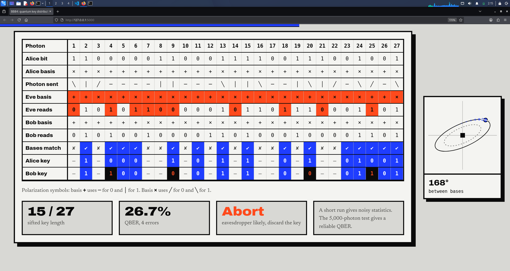

# BB84 Quantum Key Distribution Simulation

An interactive simulation of the **BB84 protocol**, the first quantum key distribution (QKD) scheme, built as a physics term project. It has three layers: a pure Python model, a Qiskit version that uses real quantum gates, and a web demo where you can watch the protocol run, switch an eavesdropper on, and send a typed secret message.




## What is BB84?

Alice wants to share a secret key with Bob while Eve may be listening. Alice sends single photons, each encoding one bit in one of two randomly chosen polarization bases. Bob measures each photon in a randomly chosen basis. Afterwards they publicly compare **only their bases**, keep the bits where the bases matched, and compare a sample of those bits to check for errors.

Measuring a quantum state in the wrong basis gives a random result and destroys the original, so an eavesdropper who intercepts the photons causes about **25% errors** in the sifted key. Alice and Bob see the errors and discard the key.

BB84 does not send the message itself. It creates a shared random key, which then locks the message with a one-time pad (XOR).

## Features

- **Pure Python simulation** of Alice, Bob and Eve (`bb84.py`)
- **Qiskit simulation** with real `X`, `H` and measurement operations (`bb84_qisket.py`)
- **Flask backend** that runs the Qiskit simulation for the web page (`app.py`)
- **Interactive web demo** (`index.html`):
  - step-by-step protocol table (Alice, Eve, Bob, sifting, error check)
  - Eve on/off toggle and live QBER (quantum bit error rate)
  - "Run on Qiskit backend" button
  - 5,000-photon statistics with and without Eve
  - **secret message sender**: type text, run BB84 to get a key, lock the message with XOR, and unlock it as Bob
  - scroll-driven photon whose polarization angle shows which basis and bit it carries

## Project structure

```
BB84-QKD-Simulation/
├── app.py              # Flask server + Qiskit API
├── bb84.py             # Pure Python BB84
├── bb84_qisket.py      # Qiskit BB84
├── index.html          # Interactive web demo
├── requirements.txt
└── docs/               # Study notes (PDF), slides, screenshots
```

## Getting started

Requires Python 3.10 or newer.

```bash
git clone https://github.com/<your-username>/BB84-QKD-Simulation.git
cd BB84-QKD-Simulation

python3 -m venv env
source env/bin/activate        # Windows: env\Scripts\activate
pip install -r requirements.txt
```

### Run the terminal simulations

```bash
python3 bb84.py
python3 bb84_qisket.py
```

Expected output: about 0% QBER without Eve and about 25% with Eve. Small runs vary around 25% because the QBER is an average over a limited number of random outcomes.

### Run the web demo

```bash
python3 app.py
```

Then open **http://localhost:5000** in your browser. Open it through this address rather than double-clicking `index.html`, otherwise the "Run on Qiskit backend" button cannot reach the server.

## Using the demo

1. **Simulator:** drag the photon slider, tick *Eve intercepts every photon*, and press **Start / next step** to walk through the protocol, or **Run all steps** to see the result at once. Press **Run on Qiskit backend** to run the same protocol on real Qiskit circuits.
2. **Send a message:** type a message (up to 32 characters) and press **Encrypt and send**. With Eve on, the error check trips the alarm and nothing is sent. Tick *Send even if the alarm goes off* to see Bob's garbled result.
3. **5,000 photons:** compare the error rate with and without Eve using a large sample.

## How it works

| Layer | What it does |
|---|---|
| `measure()` rule | Same basis returns the true bit; a different basis returns a random bit |
| Qiskit circuits | Encoding applies `X` for bit 1 and `H` for the diagonal basis; Bob applies `H` before measuring in the diagonal basis |
| Sifting | Keep only positions where Alice's and Bob's bases match (about half) |
| QBER check | Compare a sample of sifted bits; above **11%** the key is discarded |
| Message sending | Message bits are XORed with the sifted key (one-time pad); Bob XORs again with his key to recover the text |

The Qiskit backend uses `BasicSimulator`, which ships with Qiskit and needs no compiled extensions.

## Results

| Setting | Expected QBER |
|---|---|
| No Eve (ideal) | 0% |
| Eve intercepts every photon | about 25% |
| Eve intercepts a fraction *f* | about 25% × *f* |

The 25% comes from probabilities: Eve guesses the wrong basis half the time, and Bob then errs half the time on those photons, so ½ × ½ = ¼.

## Limitations

This is an idealised model. It does not include photon loss, detector noise, multi-photon pulses or attacks other than intercept-resend. A real system also needs error correction, privacy amplification and an authenticated classical channel.

## Further reading

- C. H. Bennett and G. Brassard, *Quantum cryptography: Public key distribution and coin tossing*, 1984
- P. W. Shor and J. Preskill, *Simple proof of security of the BB84 quantum key distribution protocol*, 2000
- M. A. Nielsen and I. L. Chuang, *Quantum Computation and Quantum Information*
- [Qiskit documentation](https://docs.quantum.ibm.com)

